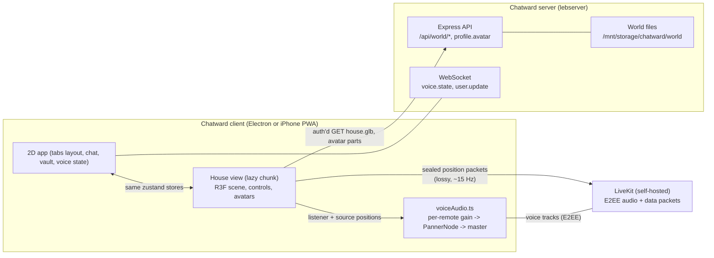

# House mode (3D) — design

Status: **proposal, nothing built yet.** This is the plan for a toggleable 3D mode in Chatward, set in a model of
Caleb's house. It is grounded in the code on `develop` as of `ef73073`.

> **Privacy note.** The house is a real home. Its street address is deliberately not written anywhere in this repo,
> and the model, photos and measurements never go into git. See [Privacy of the house](#privacy-of-the-house).

## 1. What we are building

A second way to be in a Chatward server: instead of the 2D tabs, you walk through a 3D model of the house in first
person, and the people you would normally see in the member list and voice channel are there as characters.

| Ask | How it works in this design |
|---|---|
| The house, modeled in Blender | Modeled by hand in Blender from Caleb's floor plan, measurements and photos (or an iPhone LiDAR room scan), exported as an optimized glTF for phones. §4 |
| 3D space instead of the 2D text + voice | A new **House** view that takes the main region (full screen on phones). The 2D app stays mounted under it, so chat, calls and keys keep running. §6 |
| Toggleable mode on the 2D app | One button (top bar on phones, tab bar on desktop) flips between 2D and House. The call never drops when you flip. §6.1 |
| First person, everyone has a customizable character | Own view is first person (hands + phone only). Others see your avatar: a modular low-poly character with a saved look. §7 |
| Text chat from the player's phone | In the house your character pulls out a phone. The phone screen *is* the real Chatward chat (the existing `ChatView` + `Composer`), so typing works the same as 2D. Others see you holding a phone with a typing dot, and new messages pop as a short bubble over the sender. §8 |
| Voice joined as soon as you enter the house | The house is bound to one voice channel. Walking through the front door joins that channel's call (the existing LiveKit E2EE call). Leaving the house leaves the call. §9 |
| Voice volume by distance | Each remote voice track goes through a WebAudio `PannerNode` placed at that person's avatar, with wall occlusion. Positions are sent encrypted over the call itself. §9, §10 |
| The Vault is a closet | A real closet in the model. Open it and the shelves show album boxes and framed thumbnails, decrypted on your device. Picking one opens the existing Vault viewer. §11 |

How I read "text chat is done from the user's phone": in House mode, the chat lives on an **in-game phone** your
character holds, and on a real iPhone that in-game phone fills the screen, so the real phone and the in-game phone
feel like the same thing. If Caleb meant "your real phone is a controller while a PC shows the 3D view", that is
possible later (§15, open question 3), but it is not the first version.

## 2. Ground rules

1. **No new trust in the server.** Chat, the Vault and calls are end-to-end encrypted today. House mode keeps that:
   positions, typing state and anything said or shown travel sealed with keys the server never has, exactly like the
   watch party's encrypted snapshots (`modules/watchparty.ts`).
2. **2D stays complete.** Every feature is still reachable in 2D. House mode is an extra view, not a replacement, and
   it adds nothing that only works in 3D except walking around.
3. **Phone first.** The iPhone home-screen app (PR #480's phone layout) is the main target. The desktop app and
   desktop browsers come for free from the same renderer code.
4. **Costs nothing when off.** All 3D code and assets load on first use, the way skin packs already do
   (`skins/index.ts` uses `import.meta.glob`). Someone who never opens the house downloads nothing extra.
5. **Self-hosted.** Everything is served by the existing Chatward server on lebserver. No new container, no cloud
   service, no third-party asset CDN.

## 3. Architecture at a glance



What changes where:

| Area | Change | Size |
|---|---|---|
| `packages/client` | New `components/house/` (lazy), a `houseMode` UI state, a panner stage in `state/voiceAudio.ts`, a position channel in `state/voice.ts`, phone-shell wrapper around `ChatView`, closet view over `components/vault` | Large |
| `packages/server` | `modules/world.ts`: serve house + avatar assets to members only; a `world` field on voice channels; `avatar` on the user profile with validation | Small |
| `packages/shared` | `Channel.world?`, `UserProfile.avatar?`, `AvatarConfig`, position packet codec | Small |
| `deploy/home` | A `WORLD_DIR` volume next to `VAULT_DIR`; CSP unchanged (WASM already allowed for the photo sorter) | Tiny |
| Blender | `.blend` source and the export script, kept **outside** the repo with the house photos | Separate |

## 4. Modeling the house in Blender

### 4.1 What Caleb needs to supply (open question 1)

We will not look the address up online, use listing photos, or pull any public records. Everything comes from Caleb.
In order of usefulness:

1. **An iPhone room scan, if anyone has an iPhone Pro (LiDAR).** Apple's RoomPlan (used by apps such as Polycam's room
   mode and Apple's own sample app) produces walls, doors, windows and big furniture as clean, measured boxes and exports
   USDZ, which Blender imports directly. One scan per room, 2–3 minutes each. This saves days of measuring.
2. **Otherwise, a floor plan sketch with measurements.** Phone photo of a hand drawing is fine. Per room: wall lengths,
   ceiling height, each door and window (width, height, sill height, distance from a corner), stairs (rise, run, count).
   A laser measure makes this an afternoon.
3. **Photos of every room:** one from each corner, plus close-ups of floors, counters, rugs and anything with a
   distinctive texture or color. These are used for color and texture reference only.
4. **A furniture list per room** with rough sizes (couch 220×95 cm, bed queen, TV 65", etc.).
5. **Which closet is the Vault**, which room has the TV, and whether to include the yard/porch and any upstairs or
   basement.

### 4.2 Modeling approach

- **Style: stylized, not photoreal.** Clean low-poly shapes with baked lighting and flat or lightly textured materials
  (think a cosy diorama). It reads well on phones, is far cheaper to build and run, and it hides the small errors that
  hand measurement always has. Photoreal is a much bigger project and the first thing iPhones would choke on.
- **Units and scale:** metric, 1 Blender unit = 1 m, origin at the front door threshold, +Y north. Getting real scale
  right matters for voice distances (§9).
- **Shell first:** floor plan image as a reference plane, extrude walls (or start from the RoomPlan USDZ), cut doors and
  windows with booleans, apply them, then clean up. Ceilings as separate objects per room so they can be hidden for a
  top-down map.
- **Furniture:** block out with simple shapes; replace the important pieces (couch, kitchen, TV, bed, closet) with
  modeled ones. Filler props from CC0 kits (Kenney, Quaternius, Poly Haven) are fine; nothing with unclear licensing.
- **Collections that become glTF nodes with fixed names**, which the client looks up:
  - `visual/*` — what is drawn
  - `collision` — one simplified, invisible mesh: floors, walls, stairs as ramps, big furniture as boxes
  - `rooms/<room-id>` — one invisible volume per room, used for "which room am I in" and voice occlusion (§9.3)
  - `portals/<a>__<b>` — door openings between rooms, with an open/closed flag
  - `anchors/*` — empties: `spawn_porch`, `spawn_inside`, `vault_closet`, `vault_shelf_01…`, `tv_screen`, `seat_*`
  - `doors/*` — door leaves with their hinge as origin, so the client can swing them
- **Lighting:** bake light and ambient occlusion in Cycles into a lightmap (second UV set) per area. Real-time lights
  stay at one directional "sun" plus an ambient term, so phones do almost no lighting work. Night mode later is a
  second lightmap set.
- **Where to bake:** Caleb's PC is the easy choice. lebserver's GTX 1080 Ti can bake headless (`blender -b -P bake.py`)
  if the installed Blender version still supports Pascal CUDA; check before relying on it.

### 4.3 Export and optimization for phones

A small script (`tools/world/build-house.sh`, also kept with the Blender files) turns the `.blend` into what the
client loads:

1. Blender glTF exporter → `house.raw.glb` (Y-up, apply modifiers, include custom properties, separate lightmap UVs).
2. [`gltf-transform`](https://gltf-transform.dev) CLI:
   - `dedup`, `prune`, `weld`, `join` (merge static meshes per material to cut draw calls), `instance` for repeated
     props
   - `meshopt` geometry compression (decoder is a small WASM file served by us; CSP already allows WASM)
   - `ktx2` textures via `toktx` (ETC1S for colour, UASTC for lightmaps), max 1024 px, 512 px for small props
3. Split output: `house.glb` (visuals), `house.collision.glb` (collision + rooms + portals + anchors), and a
   `manifest.json` with content hashes and sizes.

Budgets (checked by the build script, which fails if they are exceeded):

| Budget | Target | Why |
|---|---|---|
| Download (`house.glb` + collision) | ≤ 15 MB, ideally ≤ 8 MB | First open on cellular over Tailscale |
| Triangles drawn at once | ≤ 150k | Older iPhones at 60 fps |
| Draw calls | ≤ 120 | Same |
| GPU texture memory | ≤ 120 MB after KTX2 | iOS kills home-screen apps that use too much memory |
| Collision mesh | ≤ 10k triangles | BVH builds in < 50 ms on a phone |

## 5. Engine choice

**Recommendation: Three.js through React Three Fiber (R3F v8, which supports React 18), plus `@react-three/drei` and
`three-mesh-bvh`.**

| Option | For | Against |
|---|---|---|
| **Three.js + R3F** (recommended) | Same React 18 + zustand + Vite stack as the client, so the House view can read the existing stores directly; huge ecosystem (glTF, KTX2, meshopt loaders); `three-mesh-bvh` gives fast capsule collision and raycasts for occlusion; tree-shakes well into a lazy chunk (~200 KB gz) | We assemble pieces ourselves (controls, character controller) |
| Babylon.js | Batteries included (physics, GUI, inspector), very good on mobile | Big bundle, its own scene/UI model alongside React, little reuse of existing components |
| PlayCanvas engine | Excellent mobile performance | Editor-centric workflow, less natural with our React app |
| Unity/Godot web export | Full game engines | Large downloads, poor iOS Safari memory behaviour, a second codebase that cannot reuse `ChatView`, Vault or E2EE code |

Physics: no general physics engine at first. A capsule vs. BVH character controller (the `three-mesh-bvh` example
pattern) handles walls, furniture and stairs-as-ramps. Rapier (WASM) is the upgrade path if we ever want thrown objects.

Renderer: `WebGLRenderer` (WebGL 2). Three's `WebGPURenderer` can be tried later; it is not needed for this scene.

## 6. House view in the client

### 6.1 The 2D / 3D toggle

- A **`houseMode`** flag in UI state (not in `Settings`, which is the saved per-device preference store, though we save
  "open in house mode last time" there for convenience).
- **Where the toggle lives:** on phones, a house button in the top bar next to People; on desktop, a **House** entry in
  the tab bar after Voice (same list in `TabsLayout.tsx`, so LCARS and Orbit pick it up automatically, as their docs
  require). Only shown in servers that have a house channel (§9.1).
- **What stays running:** the 2D tree stays mounted; the House view is an overlay over the `main` region (full screen in
  the phone layout). Flipping is instant in both directions and never touches the call.
- **What happens to your avatar when you flip to 2D while in the call:** it stays where you left it, sits or idles,
  and shows a small "2D" badge. Proposed default: you keep hearing people by distance from that spot, so flipping does
  not suddenly make everyone loud. Open question 4.
- **Skins:** the House HUD (joystick, buttons, phone frame, labels) uses the theme tokens, so every skin dresses it like
  the rest of the app. The 3D scene itself is not skinned. New controls get entries in `test/skins/inventory.ts` so the
  parity check covers them.
- **Fallback:** no WebGL 2, or the device fails the first-load memory probe → the toggle shows "House mode isn't
  available on this device" and 2D carries on.

### 6.2 Controls

| | Phone | Desktop |
|---|---|---|
| Move | Left thumb virtual stick (appears where you touch) | WASD / arrows, Shift to run |
| Look | Drag on the right side | Mouse with pointer lock (click the scene), Esc to release |
| Interact | Tap the glowing thing, or the context button that appears near it | E or click |
| Phone (chat) | Phone button bottom-right | T or Enter |
| Mute / deafen / leave | The existing call controls (`VoiceDock`), docked in the HUD | Same |

Comfort: no head bob, 70–75° FOV by default with a slider, optional snap turning, walking speed ~1.4 m/s (run 3 m/s).
Respects reduced motion (no camera easing, instant door swings).

### 6.3 Performance plan on phones

- Device pixel ratio capped at 1.5 (adaptive down to 1.0 when frame time > 20 ms for 2 s).
- Frame loop only while the view is visible; pauses on `visibilitychange`, like the LEBAI black hole.
- Room-based culling: only the current room, rooms seen through open portals, and their avatars are drawn.
- Avatars: one shared skinned mesh + texture atlas; outfit parts as instanced meshes; animation mixers update at half
  rate for avatars more than 6 m away.
- Thumbnails in the closet: at most 24 textures alive, LRU, created from the already-cached `ImageBitmap`s.
- A "Low graphics" switch (no shadows on avatars, lightmap only, DPR 1.0).

## 7. Characters and customization

### 7.1 Avatar model

- **One modular, rigged base character** (stylized, ~6–8k triangles), built in Blender or adapted from a CC0 kit
  (Quaternius' modular characters are CC0 and come rigged). Parts swap on the same skeleton: head shape, hair, top,
  bottom, shoes, hat, glasses/accessory.
- **Colour slots** (skin, hair, top, bottom, shoes, accent) drive a small palette texture, so recolouring costs no extra
  textures.
- **Face:** a simple stylized face texture with a few presets; optionally your existing profile picture on a badge or a
  picture frame above your name tag.
- **Animations** on the shared rig: idle, walk, run, sit, wave, "holding phone", "typing on phone", talking (light head
  and jaw movement driven by the voice level that `voiceLevel()` already measures).
- **Name tag:** display name over the head, with the speaking ring colour used in 2D.

### 7.2 Saving the look

The look is not secret (others must see it), so it sits with the public profile, like the accent colour:

```ts
// packages/shared
export interface AvatarConfig {
  v: 1;
  body: 'a' | 'b';            // base proportions
  head: string; hair: string; top: string; bottom: string; shoes: string; hat: string | null; extra: string | null;
  colors: { skin: string; hair: string; top: string; bottom: string; shoes: string; accent: string }; // #rrggbb
}
// UserProfile gets: avatar: AvatarConfig | null
```

The server validates it (known part ids from the asset manifest, colour format, ≤ 1 KB) on the existing profile update
route and announces it with the existing `user.update` event, so nothing new is needed for live updates. `null` means
a default look generated from the user id.

### 7.3 The editor

"Edit character" in the profile editor and on the porch (§9.2): a turntable preview with categories and colour
swatches, the same `Sheet` pattern the phone layout already uses for dialogs. On desktop it opens in the settings
modal.

## 8. Text chat on the in-game phone

- The phone button raises a phone in your hands (first-person) and opens a **phone frame overlay** that contains the
  real `ChatView` and `Composer` for the house's paired text channel (open question 5: which text channel). On a real
  phone this frame is the full screen with a thin 3D strip still visible at the top, so you can keep seeing the room.
- Nothing about sending changes: same MLS encryption, same uploads, GIFs, emoji, replies, push notifications.
- **What others see:** your avatar plays "holding phone", and while you type it shows a typing dot (from the existing
  `typing` WebSocket event, so no new signal). When a new message arrives, a short bubble (first ~60 characters,
  5 seconds) appears over the sender's head. The bubble is drawn from the decrypted message each client already has.
  Bubbles show only for people in the same or adjacent room; the full message is always on the phone.
- Moving while the phone is up: allowed at walking speed with the stick still visible (on phones the stick moves above
  the keyboard).

## 9. Voice: auto-join and distance

### 9.1 One house = one voice channel

- A voice channel can be marked as a house: `Channel.world?: { kind: 'house'; worldId: string }`, set by an admin in
  Server settings. The `world` field is stored in the `channels` table; nothing else in the voice module changes, so
  kicks, bans, moves, grace on reconnect, device rules and E2EE keys all keep working as they do now.
- The LiveKit room is still the channel id, and the call key is still derived from the channel key
  (`IndexedKeyProvider` in `state/voice.ts`).

### 9.2 Entering the house

1. Opening House mode puts you on the **porch** (spawn anchor outside the front door). The porch is local only: you
   can edit your character, check your mic, and see through the windows who is inside (from `voice.state`, which the
   server already broadcasts). You are not in the call yet.
2. Walking through the front door (or tapping "Go inside") calls the existing join flow for the house channel. Your
   avatar appears inside at `spawn_inside` for everyone once your first position packet arrives.
3. Walking back out the front door, or Leave, calls the existing leave flow.
4. If you are already in another voice call, the door asks "Leave #other and go inside?" (a user is in at most one
   call; the server already enforces that).
5. Mic: proposed default is to join **unmuted** with the usual mute button in the HUD, as the ask says "voice is joined
   as soon as you enter". The first time, iOS shows its microphone prompt at the door, which is also the user gesture
   iOS needs to start audio. Open question 6.

### 9.3 Distance and walls

The hook already exists. `state/voiceAudio.ts` builds, per remote track:
`source -> gain (per-user volume) -> master -> output`. House mode inserts one node:

```
source -> gain (per-user volume) -> occlusion (BiquadFilter lowpass + gain) -> panner (PannerNode, HRTF) -> master
```

- `PannerNode` with `panningModel: 'HRTF'`, `distanceModel: 'inverse'`, `refDistance: 1.5 m`,
  `rolloffFactor: 1.2`, `maxDistance: 20 m`, and a hard fade to silence past a **cutoff of 15 m** (tunable per house in
  the manifest). The listener (`AudioContext.listener`) follows your camera; each panner follows that person's avatar
  head. Positions are set with `setTargetAtTime` (~50 ms) so movement never clicks.
- **Walls:** each update, a raycast from you to each speaker against the collision BVH counts wall hits. Same room:
  clear. Through an open door: about −6 dB and a 4 kHz lowpass. Through one wall: about −14 dB and a 1 kHz lowpass. Two
  or more walls: −24 dB. This sounds like "someone talking in the next room" without any real acoustics.
- **Stereo on phone speakers** is weak, so on the built-in speaker we switch `panningModel` to `'equalpower'` and rely
  on distance and walls; with headphones HRTF gives real direction.
- **When the panner is off:** in 2D mode with "spatial in 2D" turned off, or outside a house channel, the graph is
  exactly today's graph. The per-user volume slider (`MemberMenu`) still multiplies on top.
- **Screen share sound and soundboard:** screen share sound stays non-spatial (it is the TV, see §12). Soundboard sounds
  play from the person who triggered them (spatial), since they come from their avatar's position.
- **Bandwidth:** LiveKit still forwards every voice to every listener (it is an SFU). For ~10 people that is fine. If
  phones struggle, unsubscribe from tracks beyond the cutoff (`RemoteTrackPublication.setSubscribed(false)`) and
  resubscribe at 13 m.

The distance and occlusion maths live in a pure module (`house/audioMath.ts`) with unit tests, like `searchMatch.ts`.

## 10. Multiplayer state sync

### 10.1 What is synced, and how

| State | Path | Rate | Encrypted |
|---|---|---|---|
| Position, yaw, pitch, animation, flags (phone up, sitting, in 2D, talking) | LiveKit data packet, **lossy**, to the room | 15 Hz while moving, 2 Hz idle | Yes: sealed with AES-GCM using the call's key, before LiveKit sees it |
| Joins and leaves | Existing `voice.state` WS event | On change | Server-visible, as today |
| Typing | Existing `typing` WS event | On change | As today |
| Look (avatar) | Existing profile + `user.update` | On change | Public, like the profile today |
| Door open/closed, TV state, things you can move | LiveKit data packet, **reliable** | On change | Yes, same key |
| Persistent house state (which photos hang on the wall, door states when nobody is home) | Encrypted snapshot route like `modules/watchparty.ts`, but saved to the database | On change | Yes, server stores ciphertext only |

**Why LiveKit data packets** rather than the WebSocket: they already exist on every client in the call, they go
through the same low-latency path as the voice, positions only matter to people in the call, and the server does not
learn anyone's position. Sealing them ourselves with the call key means it does not matter whether the installed
`livekit-client` version encrypts data packets on its own (check when implementing; if it does, we can drop our own
layer).

### 10.2 Packet format

Binary, 32 bytes before sealing, defined and tested in `packages/shared` (like the demo mode `codec.ts`):

```
u8  version | u8 flags | u16 seq | f32 x | f32 y | f32 z | i16 yaw | i16 pitch | u8 anim | u8 room | u16 reserved | u32 t_ms
```

Sealed = 12-byte IV + ciphertext + 16-byte tag = 60 bytes. Ten people at 15 Hz is ~9 KB/s per listener in total.

### 10.3 Simulation model

- **Client-authoritative movement.** Each client moves its own avatar with the local collision and sends results. This
  is a private server for friends, so anti-cheat is not worth server-side physics. Out-of-house positions or teleports
  are clamped on receive (anything outside the house bounds is ignored).
- **Interpolation:** remote avatars are drawn ~100 ms in the past between the two packets around that time;
  extrapolate at most 200 ms on packet loss, then freeze.
- **Ordering:** `seq` per sender; older packets dropped.
- **New arrivals:** every client sends one reliable "full state" packet when someone joins the room
  (`RoomEvent.ParticipantConnected`), so the newcomer sees everyone in place at once.
- **Identity:** LiveKit identity is the user id (as today), so packets map straight to members. All devices of one
  account share an identity; the server already allows only one device in a call at a time, so this is safe.

## 11. The Vault closet

- The closet is a real place in the model (`anchors/vault_closet`) with a door. Walk up, tap, the door swings open and
  the camera moves to face the shelves.
- **Shelves:** each Vault album is a labelled storage box; the three newest items of each album sit in small frames in
  front of it; "All photos" and the meme sorter's groups (from PR #468's on-device sorter) are boxes too. Thumbnails come
  from the Vault's existing client-side decryption and IndexedDB cache (`vaultIndex.ts`), turned into textures, at most
  24 at a time.
- **Opening something:** tapping a box or a frame opens the **existing** `VaultView` (and its full-screen viewer on
  phones) as an overlay, filtered to that album. Uploading, albums, annotations and deleting all happen there, so the
  closet adds no new Vault logic and no new encryption.
- **Who sees what:** every member's client decrypts the Vault itself, so two people in the closet each see the same
  albums on their own screens; nothing is streamed between them.
- **Later:** a "Walls" album whose photos hang in frames around the house; drag a photo from the closet to a frame.
  The frame-to-photo mapping is persistent house state (§10.1, encrypted).

## 12. Nice extras that fall out of this (not in the first version)

- **Living room TV = watch party.** The `tv_screen` anchor shows Vault and Jellyfin videos as a `VideoTexture`
  (same-origin `blob:` URLs work). YouTube cannot be drawn into WebGL (cross-origin iframe), so sitting on the couch
  opens the existing watch-party player as an overlay instead. Screen shares can show on the TV too.
- **Workouts:** the crew's week on a fridge whiteboard.
- **LebBot** as an NPC in the house. Out of scope here; noted only because people will ask.

## 13. Server side

- `modules/world.ts`
  - `GET /api/world/:worldId/manifest` and `GET /api/world/:worldId/:hash.:ext` — members of a server that has a house
    channel for that world only (`ctx.requireAuth` + membership), `Cache-Control: private, max-age=31536000,
    immutable` (files are content-hashed). Not served from the public web bundle.
  - Files live in `WORLD_DIR` (`/mnt/storage/chatward/world` on lebserver, a Docker volume like `VAULT_DIR`). An admin
    uploads a built house with a small CLI (`node dist/admin.js world-import <dir>`), which the existing admin socket
    can host.
  - Avatar part meshes are not private, so they can ship in the client bundle (lazy) instead.
- `channels` table: nullable `world` column, with a migration at start like the existing ones.
- Profile route: accept and validate `avatar`.
- Persistent house state: `world_state(channel_id, key_version, ciphertext, updated_at)`, same limits and checks as
  watch party, but stored.
- No change to LiveKit config: data packets are on by default. `deploy/home/livekit.yaml` stays as it is.

## 14. Phased rollout

Each phase is a separate PR into `develop`, behind a server feature flag (`HOUSE_MODE=1` in `.env`) until phase 4.

| Phase | Delivers | Proves | Rough size |
|---|---|---|---|
| **0. Spike** | Grey-box house from a rough plan, lazy R3F chunk, walk around on iPhone with stick + look, fps overlay | iPhone performance and memory, bundle split, controls feel | 1 week |
| **1. The real house** | Blender model v1 + bake + build script + budgets, `modules/world.ts`, `WORLD_DIR`, admin import | Pipeline end to end, privacy of assets | 2–3 weeks (mostly modeling, depends on §4.1 inputs) |
| **2. Together** | Channel `world` flag, porch, door = join/leave, encrypted position packets, preset avatars with animations, name tags | Sync quality on real Wi-Fi/cellular over Tailscale | 2 weeks |
| **3. Spatial voice** | Panner + occlusion in `voiceAudio.ts`, talk animation, settings (spatial on/off, cutoff) | It sounds like being in a house | 1 week |
| **4. Phone chat** | In-game phone overlay with real chat, typing dots, bubbles | Text works as well as 2D | 1 week |
| **5. Vault closet** | Closet interaction, shelves from albums, opening `VaultView` | Vault reuse | 1 week |
| **6. Your character** | Avatar editor, `AvatarConfig` on profiles, modular parts | Customization | 1–2 weeks |
| **7. Polish** | TV, doors, desktop pointer lock polish, low-graphics mode, demo-mode bots walking around, phone screenshots | Ready for the friends | ongoing |

Tests per phase: unit tests for the packet codec, audio maths and avatar validation (added to `test:unit` and
`test:e2e`); the demo backend (`demo/backend/world.ts`) gets bots that walk the house so `visual:capture`,
`skins:parity` and `phone:shots` can include House mode without a server.

## 15. Open questions for Caleb

1. **House inputs (§4.1):** can you send a floor plan sketch with measurements and photos of each room? Does anyone
   have an iPhone Pro for a LiDAR room scan? Include the yard/porch, upstairs, basement? Which closet is the Vault?
2. **Look:** stylized low-poly (recommended) or as realistic as possible?
3. **Real phone as controller?** First version is "the phone *is* the game". Do you also want "PC shows the house, your
   phone is the chat/controller" later?
4. **Flipping to 2D during a call:** keep hearing people by distance from where you left your avatar (proposed), or
   everyone at full volume?
5. **Which text channel** is the house's chat on the in-game phone: a fixed one per house, or the channel you last had
   open?
6. **Walking in:** join unmuted (proposed, matches "joined as soon as you enter") or muted until you tap?
7. **Who can enter:** every server member (proposed), or a role?

## Privacy of the house

- The street address is never written in the repo, the code, the UI, commit messages or asset names. The world is
  called by an id (`house`) and a display name Caleb picks.
- The `.blend` file, photos, scans and measurements stay on Caleb's PC (and a backup), not in git, because this repo
  may be shared more widely than the server.
- Built assets are only served to signed-in members of a server that has the house channel, never in the public web
  bundle and never through a CDN.
- Nothing is looked up online about the address.
- Positions inside the house are end-to-end encrypted like voice, so the server and anyone with its database cannot
  build a record of who was where in a real home.

## 16. Risks

| Risk | Impact | Mitigation |
|---|---|---|
| iPhone memory: iOS reloads home-screen apps that use too much memory, which also drops the call | High | Strict budgets checked at build time, KTX2, room culling, LRU textures, low-graphics mode, phase 0 measures on a real iPhone first |
| iPhone heat and battery with WebGL + voice | Medium | DPR cap, frame loop pauses when hidden, 30 fps cap option |
| iOS audio: WebAudio needs a user gesture, HRTF CPU cost, audio routing changes when the mic opens | Medium | The door tap is the gesture; equal-power on speaker; ≤ 10 panners is cheap; reuse the existing playback context |
| Modeling takes longer than the code | High | Stylized style; RoomPlan scan if possible; grey-box first so code is never blocked on art |
| Motion sickness on phones | Medium | No head bob, FOV slider, snap turn, sit-down spots |
| Scope creep (games, NPCs, more houses) | Medium | Phases above; extras listed separately |
| A second UI to keep working across 4 skins × 4 layouts | Medium | House HUD uses tokens only; House view is one entry in `TabsLayout`, so LCARS/Orbit get it; parity inventory updated |
| Privacy of a real home's layout | High | §Privacy: no address, assets outside git, members-only serving, encrypted positions |
| `livekit-client` version differences for data packets / E2EE | Low | Our own sealing layer; integration test in `test:e2e-client` |
